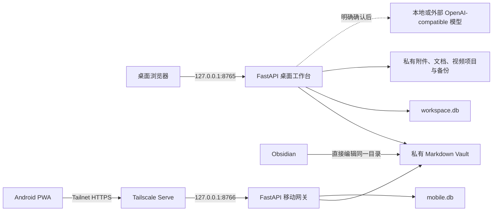
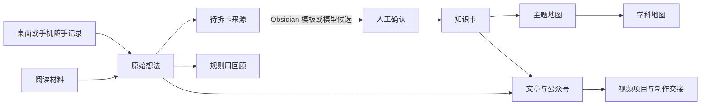
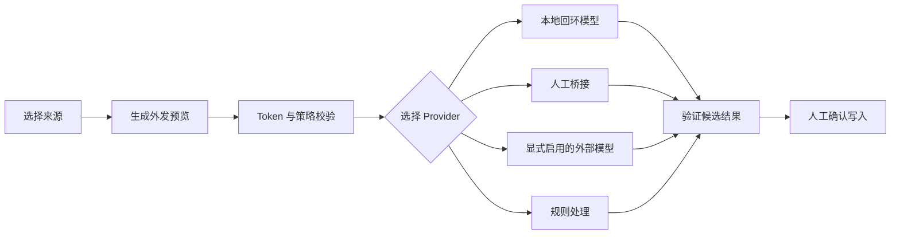

# 系统架构

本文描述羽白工作台的设计事实、组件边界和关键数据流。具体文件职责和扩展约束见 [开发指南](DEVELOPMENT.md)。

## 架构原则

- **本地优先**：Mac 是唯一权威数据源，完整应用不暴露到公网。
- **按数据性质存储**：可读可迁移的内容使用 Markdown，关系和索引使用 SQLite，附件使用私有文件目录。
- **来源不可变**：总结、知识卡、文章、视频和模型结果都是派生物，不覆盖原始记录。
- **零复制知识**：Obsidian 和工作台编辑同一份 Markdown，手机只读取安全投影。
- **显式模型调用**：规则优先，所有模型任务先预览、再执行、再确认写入。
- **渐进增强**：桌面使用服务端 HTML 与 HTMX；禁用 JavaScript 后核心表单仍可工作。

## 系统边界



桌面服务和移动网关是两个独立 FastAPI 应用。移动网关只暴露记录、最近内容和只读知识页面，不能转发桌面路由。

## 表现层

### 桌面工作台

- FastAPI 应用工厂负责依赖装配、路由和安全中间件。
- Jinja2 渲染共享布局、页面和 HTML partial。
- HTMX 只用于搜索、筛选和局部刷新，普通 GET/POST 表单保持可用。
- D3 只渲染核心知识图；图数据来自服务端安全 JSON 投影。
- 微信发布页使用本地脚本处理剪贴板、公式和图片，不引入前端构建系统。

### Android PWA

- 独立移动模板和静态资源，不复用桌面管理页面。
- Service Worker 只缓存应用外壳，不缓存私人知识、最近记录或 API 响应。
- IndexedDB 只保存尚未同步的新记录和图片 Blob，收到成功回执后立即删除。

## 领域与服务

| 领域 | 主要职责 |
|---|---|
| 内容工作台 | `ContentItem` 解析、创建、编辑、状态流转、回收和周回顾 |
| 正式知识 | `KnowledgeMap`、`KnowledgeCard`、关系校验、来源追踪和核心图投影 |
| Obsidian 桥接 | Vault 扫描、Revision、Templates 收件箱、分层链接、迁移预演和回滚 |
| 创作发布 | 微信正文渲染、候选文章保护、视频项目和多格式制作交接 |
| 求职学习 | 档案、私有文档、项目、简历、职位、技能差距、任务和战役 |
| 模型治理 | Provider 策略、Token 上限、人工桥接、调用执行和用量账本 |
| 移动同步 | 配对、设备会话、幂等回执、图片事务和只读知识投影 |
| 系统能力 | 本地检索、私有文件、原子写入、访问控制和加密备份 |

目前多数桌面路由仍集中在 `app/main.py`，但领域逻辑已经分散到独立模块。未来拆分 Router 时必须保持 URL、安全中间件和服务接口兼容。

## 数据分层

```text
~/Library/Application Support/personal-creative-workspace/
├── content/
│   ├── sources/
│   │   ├── inbox/             # Obsidian 普通笔记收件箱
│   │   ├── thoughts/          # 原始想法
│   │   └── materials/         # 阅读材料及来源记录
│   ├── knowledge/
│   │   ├── inbox/             # Obsidian 知识模板收件箱
│   │   ├── cards/             # 正式原子知识卡
│   │   ├── maps/              # 学科和主题地图
│   │   └── indexes/           # 可删除、可重建索引
│   ├── outputs/
│   │   ├── articles/          # 文章草稿与成稿
│   │   └── reviews/           # 周回顾
│   ├── assets/                # 私有图片
│   ├── archive/
│   ├── trash/
│   ├── _templates/            # Obsidian Core Templates
│   ├── 知识首页.md
│   └── .obsidian/             # 本地配置，不进入备份
├── documents/                 # 随机存储名的私有上传
├── video-projects/            # 视频项目和交接包
├── workspace.db               # 求职、学习、搜索与模型元数据
├── mobile.db                  # 移动设备、会话哈希和幂等回执
├── mobile.secret              # 移动令牌哈希密钥
├── working/model-tasks/       # 七天临时任务，不进入备份
└── backups/                   # 加密备份包
```

Markdown 是想法、知识卡、地图、文章、周回顾和材料记录的权威格式。SQLite 不保存这些正文的第二份副本；FTS5 内容可从权威数据重建。

## 内容与知识生命周期



正式知识只有地图和知识卡。原始想法中的旧学科、概念和关系字段只为迁移读取，不再生成第二套图谱。知识卡必须保留来源；冲突使用 `contrasts`，明确替代使用 `superseded_by` 和有效时间。

## 模型任务生命周期



模型任务不会在页面加载、保存内容、定时任务或后台线程中自动触发。账本只记录用量元数据，不保存外发正文、完整提示词、响应或密钥。

## 一致性与并发

- Markdown 和附件写入使用跨进程文件锁、临时文件、`fsync` 和原子替换。
- 工作台编辑表单携带语义 Revision；Obsidian 在页面打开后修改文件时，工作台返回 409 对比页。
- 手机捕获使用稳定幂等键；网络重试返回同一内容 ID，不重复创建文件。
- 图片和 Markdown 作为一次逻辑事务保存，内容失败时清理本次新增图片。
- SQLite 启用事务和外键；移动数据库不在设备之间同步。

## 安全架构

- 桌面中间件拒绝非回环客户端、异常 Host、代理转发头和跨站写请求。
- 移动中间件只接受配置的 Tailnet HTTPS Origin 和来自本机代理的请求。
- 所有私人响应设置 `Cache-Control: no-store`、CSP、禁止嵌入和 MIME 嗅探保护。
- `/static` 只包含代码资源；私人图片和文档必须经过受保护路由。
- OpenAPI、Swagger、ReDoc 和 CORS 不启用。

完整威胁模型和操作边界见 [安全说明](SECURITY.md)。

