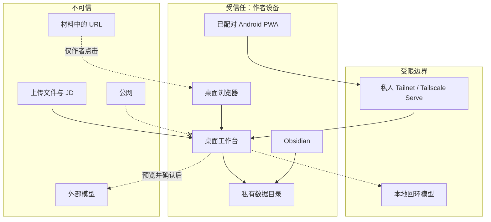

# 安全说明

羽白工作台会保存想法、照片、简历、职位、模型材料和其他个人信息。本文件定义必须长期保持的信任边界。

## 安全目标

- 完整工作台只由作者在本机使用。
- Mac 是唯一权威数据源，私人数据不上传 Git 或公共云数据库。
- 手机只通过私人 Tailnet 访问最小移动网关。
- 模型只收到作者预览并确认后的材料。
- 上传内容、模型输出、JD 和外部 Markdown 永远作为不可信输入处理。
- 删除、迁移和恢复都提供确认、校验或回滚路径。

## 信任边界

## 网络边界

### 桌面服务

- 固定监听 `127.0.0.1:8765`。
- 同时检查客户端地址、Host、Origin、CSRF 和代理转发头。
- 拒绝远程地址、异常 Host、DNS 重绑定、伪造代理头和跨站 POST。
- 不配置 CORS，不启用 OpenAPI、Swagger 或 ReDoc。
- 不允许通过 `0.0.0.0`、局域网、Vercel、Funnel 或其他公网代理暴露。

### 移动网关

- 固定监听 `127.0.0.1:8766`，只允许本机 Tailscale Serve 代理。
- 只接受设置中登记的 Tailnet HTTPS Host 和严格 Origin。
- 未配对、已撤销、会话过期、异常代理头和直接远程请求全部拒绝。
- 只提供随手记录、最近记录和正式知识只读投影。
- 禁止 Tailscale Funnel；Tailnet 不应共享给不受信任成员。

## 浏览器和会话

- 私人响应统一使用 `Cache-Control: no-store`。
- CSP 限制脚本、样式、图片和连接来源。
- 使用禁止嵌入和 MIME 嗅探保护，降低点击劫持和内容类型混淆风险。
- 桌面 POST 使用 CSRF 与同源校验。
- 移动设备令牌只以哈希形式保存在服务端；Cookie 使用 `Secure`、`HttpOnly` 和 `SameSite=Strict`。
- Service Worker 不缓存知识页、最近记录、API 响应或私人图片。
- IndexedDB 只保存尚未同步的移动捕获，成功回执后删除。

## 私有存储

- 默认根目录位于 macOS Application Support，而不是 Git 仓库。
- 目录权限为 `0700`，Markdown、SQLite、上传、图片、备份和密钥为 `0600`。
- Markdown 与附件写入使用跨进程锁、临时文件、`fsync` 和原子替换。
- 私人附件不放入 `/static`，只通过验证过的受保护路由读取。
- `.obsidian/`、移动会话、模型临时任务和 API Key 不进入内容备份。
- 应开启 macOS FileVault，并为 Android 设置可靠锁屏和设备加密。

## 上传与外部内容

- 允许的私有文档类型为 PDF、DOCX、Markdown、TXT、PNG 和 JPEG；移动图片额外允许 WebP。
- 同时校验扩展名、真实文件签名、大小、数量和路径边界。
- 拒绝 HTML、SVG、宏文档、脚本、可执行文件、路径穿越和伪造扩展名。
- 服务端使用随机存储名，不信任上传文件名。
- JD、简历、材料和图片中的文字不能改变系统指令或触发工具调用。
- URL 只保存，不自动访问；需要打开时由作者显式点击。

## Markdown 与发布

- 原始 HTML 输入保持关闭。
- `javascript:`、危险图片地址、Vault 私有路径和越界相对路径不会进入渲染输出。
- 微信复制使用由可信 Markdown 解析得到的行内样式 HTML。
- 本地图片内嵌只是复制辅助，发布前仍需确认公众号已重新托管。
- Obsidian 生成链接区块不进入模型、搜索、周回顾、公众号或视频正文。

## 模型外发

- 所有模型任务经过 `ModelGateway`。
- 页面加载、保存内容、定时任务和后台线程不会自动调用模型。
- 外发前展示来源、完整材料和 Token 估算，允许作者删除或脱敏。
- `local` Provider 只接受回环地址；`external` 默认关闭。
- ChatGPT/Codex 登录态、Cookie 和订阅凭证不会被应用读取。
- 模型结果先作为候选数据校验，未经确认不得写入知识、文章、候选人事实或职位状态。
- 账本不保存 API Key、正文、完整提示词或响应。

## Git 和文档边界

- `.gitignore` 排除内容、所有 SQLite/DB 文件、Canvas、上传、视频项目、模型任务、备份、`.env` 和密钥。
- `tools/security_guards.py` 在 CI 检查私有目录、数据库、Canvas、密钥后缀和公网部署配置。
- GitHub 仓库保持私有，但这不能替代本地服务边界。
- 文档示例只使用虚构主机、占位密钥和通用路径，不写真实邮箱、Tailnet 主机或私人内容。
- 不提交 Vercel、Render、Railway、Fly.io 或 Procfile 等部署配置。

## 备份与删除

- 备份使用 AES-256，包含版本、文件清单和 SHA-256。
- 备份口令不保存；错误口令、内容篡改和不兼容版本必须安全失败。
- 恢复先解密到临时目录并验证，再显示冲突；确认后才替换数据。
- 替换前建立可回滚快照。
- 命令行恢复演练只接受不存在或为空的隔离目录，恢复锚点不包含正文。
- 回收站内容在明确永久删除前可恢复。
- 迁移默认 dry-run，不覆盖冲突文件，也不自动删除旧来源。

## 发布或提交前检查

- [ ] 服务仍只绑定 `127.0.0.1`，移动端没有 Funnel。
- [ ] 没有新增公网部署配置、CORS 或公开数据路由。
- [ ] 新的 POST 入口包含 CSRF、Origin 和 Host 边界。
- [ ] 新上传类型有签名、大小、文件名和路径验证。
- [ ] 模型功能经过预览、策略上限和确认写入。
- [ ] 测试只使用临时目录和虚构内容。
- [ ] `git status`、安全守卫和日志中没有私人数据或密钥。
- [ ] 完整 Pytest、Ruff、应用导入和安全守卫通过。

发现敏感内容已经进入 Git 历史时，先停止推送并确认影响范围，再单独决定是否重写历史；不要在普通功能修改中直接执行破坏性清理。
