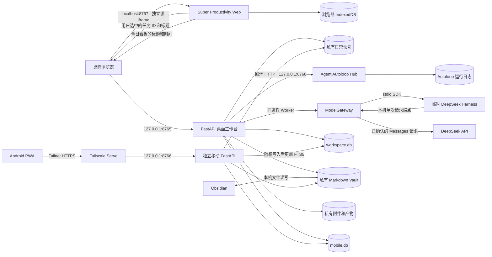

# 羽白工作台系统架构

> 盘点日期 2026-11-12。本文描述当前实现。使用与验证状态见[项目状态](../../PROJECT_STATUS.md)。

羽白工作台是运行在 Mac 上的本地单用户应用。桌面提供完整管理界面，Android PWA 通过私网查看日常工作看板和随手记录，Obsidian 与工作台编辑同一份私有 Vault。桌面默认入口是「日常工作」和「AI 工作流」。前者由 Super Productivity 管理待办和排期，后者由 Agent Autoloop 调度，工作台负责审批、执行桥接和产物验收。

## 运行拓扑

| 组件 | 代码入口 | 运行职责 |
|---|---|---|
| 桌面服务 | [桌面启动器](../../app/__main__.py)、[应用工厂](../../app/main.py)、[内置插件注册表](../../app/plugins.py) | 按领域装配路由和导航，管理私有数据、浏览器访问校验和用户审批。 |
| Super Productivity Web | [独立静态服务](../../app/plugin_web.py)、[Web 构建](../../tools/build_workbench_web.py) | 在独立的浏览器源运行日常工作。任务菜单通过 iframe 消息发起交接，桌面日常工作页通过同一桥接请求手机看板快照。 |
| AI 工作流 | [工作流路由](../../app/routers/workflow.py)、[Worker](../../app/workflow_worker.py)、[只读投影](../../app/workflow_control.py) | Worker 在桌面进程内领取任务，控制中心通过同源接口获取快照、实时通知和轮次追溯。 |
| 模型执行 | [ModelGateway](../../app/model_gateway.py)、[DeepSeek Harness 适配器](../../app/deepseek_harness.py) | 模型网关执行任务上限和输出校验。AI 工作流可用私有配置选择 Harness，本机当前使用 `deepseek-flash`。其他领域各自使用默认网关或人工桥接。 |
| 移动网关 | [移动启动器](../../app/mobile_launcher.py)、[移动应用工厂](../../app/mobile_main.py) | 独立进程和会话边界，通过 Tailscale Serve 处理随想写入与冲突合并，为已配对设备提供只读日常看板。 |
| Obsidian | [Vault 桥接](../../app/obsidian.py) | 扫描并编辑同一份文件，工作台通过文件 Revision 检测冲突，按需更新导航与索引。 |
| 服务管理 | [运行管理](../../app/runtime.py) | macOS 用户级 LaunchAgent 管理桌面服务和可选的移动网关。应用工厂在调用时初始化数据目录，ASGI 启动时同步检索并启动已启用的服务。 |

## 工作流内部边界

工作项的预览与审批由[工作流服务](../../app/workflow.py)负责。路由和 Worker 通过[工作流存储](../../app/workflow_store.py)读取事项、提交审批和更新状态。该模块管理工作流表的 SQL、事务和私有产物。控制中心通过[只读投影](../../app/workflow_control.py)组合 Hub 事实与本地引用。

[Autoloop 客户端](../../app/workflow_hub.py)统一处理回环 HTTP、服务端凭据和实时事实流。[Worker](../../app/workflow_worker.py)负责重送审批事件、领取轮次、执行及回执。[插件运行管理](../../app/plugin_runtime.py)由桌面应用工厂调用，使用同一个进程锁管理本机子进程，并分别校验和启动 Super Productivity Web 与 Autoloop。Web 仅依赖自己的包和校验值；AI 工作流依赖自己的包、Hub 配置和凭据。工作流启动时恢复未完成轮次。

## 技术栈

| 层 | 技术 | 用途 |
|---|---|---|
| 工作台后端 | Python 3.13、FastAPI、Uvicorn、Pydantic、HTTPX | 服务端页面、同源 JSON 接口、SSE、请求校验以及模型和插件通信。CI 同时验证 Python 3.11。 |
| 工作台前端 | Jinja2、HTMX、原生 JavaScript 和 CSS，本地 D3、MathJax | 服务端渲染、局部更新、工作流控制中心、知识图与公式。工作台自身的静态资源可直接运行。 |
| 日常工作和调度 | Super Productivity 20.0.0 的 Angular Web 构建、Agent Autoloop 1.8.1、Node.js 24+ | 安装时构建日常工作 Web 包并固定上游版本。桌面启动时校验已安装包的 SHA-256。 |
| 存储和文档 | SQLite、FTS5、Markdown、YAML、私有文件目录 | 结构化事务、可重建的全文索引、可直接编辑的 Vault 和私有附件。Python 依赖见[锁定清单](../../requirements.lock)。 |
| 移动端和本机运行 | PWA、Service Worker、IndexedDB、Tailscale Serve、launchd | 手机离线记录和同步、私网入口，以及 Mac 上的用户级常驻服务。 |
| 导出和验证 | Playwright Chromium、pypdf、pyzipper、Pytest、Ruff、GitHub Actions | 简历 PDF 生成与读取、加密备份、浏览器验收及持续集成。 |

## 业务模块

| 模块 | 入口 | 主要职责 |
|---|---|---|
| 日常工作 | `/` | 管理待办、月历排期、标签与专注计时，保存于 Super Productivity 的浏览器存储。 |
| AI 工作流 | `/tasks` | 管理任务交接、规则、队列、待决策卡片和执行时间线。工作项可预览外发材料、回答问题和验收候选。 |
| 主线与分支及旧待办 | `/focus`、`/legacy/planner` | 管理阶段、目标、交付物和行动，以及原有独立待办和排程。 |
| 旧任务运行时 | `/legacy/tasks`、`/runs` | 管理原有项目、任务、执行步骤与私有产物。可按规则生成工作纸或在预览后使用模型，执行由页面操作发起。 |
| 想法、知识与检索 | `/ideas`、`/knowledge`、`/library`、`/search` | 记录来源，维护知识地图与卡片，使用派生索引检索选定内容。 |
| 创作与复盘 | `/articles`、`/publish`、`/video`、`/reviews` | 管理文章和内容周回顾，生成公众号草稿、视频分镜与制作交接包。 |
| 求职与学习 | `/career`、`/learning` | 维护职位、进度、简历版本、投递快照与学习证据。 |
| 决策与收入 | `/assistant`、`/income`、`/models` | 提供白名单上下文建议、人工账本和模型用量。 |

插件注册表也负责装配内置领域模块。日常工作路由和手机看板快照由[日常工作模块](../../app/routers/daily.py)维护，与 AI 工作流控制路由分别装配。安装启用 Super Productivity 和 Autoloop 后，`/` 与 `/tasks` 使用新入口；旧待办和旧任务仍可通过独立链接访问。功能细节见[功能模块](../features/README.md)。

## 数据与权限边界

| 数据 | 权威位置 |
|---|---|
| 日常工作中的待办、计划与计时 | Super Productivity 专用浏览器源的 IndexedDB |
| 调度状态、轮次、规则生效记录和卡片 | 本机 Autoloop 持久日志 |
| AI 工作项、审批和验收，以及其他结构化业务状态 | 私有 `workspace.db` |
| AI 候选产物和文字决策 | 私有 `working/plugins/results/` |
| 随想、知识卡、知识地图、文章和内容回顾 | 私有 `content/` Vault |
| 移动设备、会话和幂等回执 | Mac 上的 `mobile.db`，手机保留离线副本和待同步草稿 |
| 全文检索与手机日常看板 | 可重建的 FTS5 索引和 Super Productivity 派生的当日只读快照。 |

桌面接口检查回环来源、Host 和写入 CSRF。移动网关另行校验 Tailnet 代理、设备会话及 Origin。浏览器只能经工作台同源接口访问工作流，Autoloop Owner Key 留在后端。SQLite 使用 WAL、外键和事务，按统一注册表迁移。Vault 写入使用跨进程锁和原子替换，冲突通过 Revision 提示人工处理。

工作台的标准加密备份包含 `workspace.db`、Vault、私有文档与视频项目。日常工作的浏览器存储、Autoloop 日志和工作流正文各自有独立备份边界。恢复方式见[存储架构](storage.md)和[桌面插件运维](../operations/workbench-plugins.md)。

从输入到写入和回执的完整路径见[关键数据流](data-flows.md)。代码和验证约束见[开发说明](../development/README.md)。
