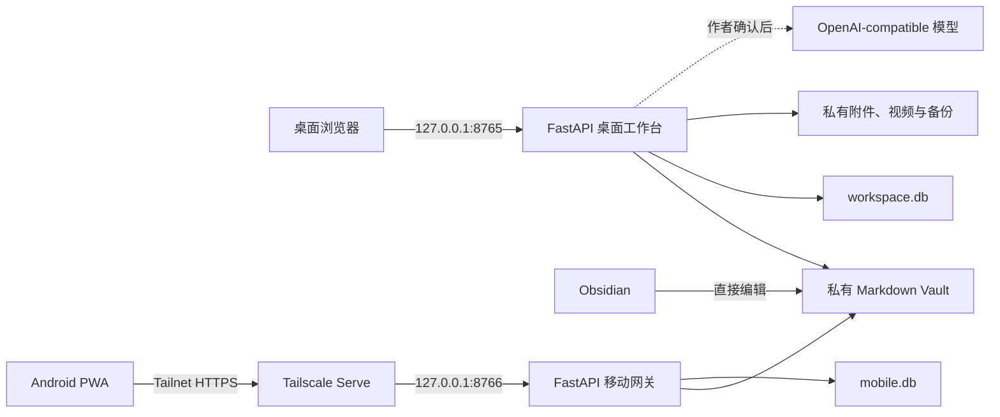
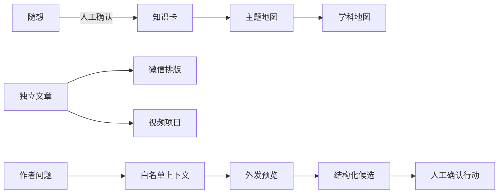

# 系统架构

## 设计原则

- **本地优先**：Mac 是唯一权威数据源，完整工作台不暴露公网。
- **按数据性质存储**：长期内容使用 Markdown，结构化关系和索引使用 SQLite，附件使用私有文件目录。
- **来源可编辑、派生不覆盖**：随想可以持续修改；知识卡、回顾、文章、视频和模型结果都是独立对象。
- **零复制知识**：Obsidian 与工作台编辑同一份 Vault，手机只保留受限快照。
- **显式模型调用**：所有模型任务先预览、再执行、再确认写入。
- **渐进增强**：桌面以服务端 HTML 和普通表单为基础，HTMX 负责局部刷新。

## 系统边界

桌面和移动是两个独立 FastAPI 应用。移动网关只提供记录、未归档随想编辑、精简拆卡和只读知识投影，不能转发桌面管理页面。

## 表现层

- 桌面：FastAPI 应用工厂、Jinja2 模板、HTMX 局部刷新、本地 D3 核心知识图。
- 移动：独立模板、Service Worker、IndexedDB 和严格设备会话。
- 微信：安全预处理、语义 HTML、受控主题和浏览器导出清洗四层流水线。
- 项目没有前端构建系统、公共 JSON API、云数据库或外部向量库。

## 领域分工

| 领域 | 责任 |
|---|---|
| 内容 | `ContentItem`、随想、文章、回顾、状态和回收 |
| 正式知识 | `KnowledgeMap`、`KnowledgeCard`、关系、Revision 和核心图 |
| Obsidian | Vault 扫描、Templates、链接、冲突和迁移预演 |
| 创作 | 微信转换、候选文章保护、视频分镜和交接 |
| 求职学习 | 档案、文档、项目证据、职位、技能、岗位雷达和任务 |
| 助手 | 高信号上下文、来源白名单、摘要和确认行动 |
| 模型 | Provider、策略、Token 上限、人工桥接和费用账本 |
| 移动 | 配对、离线操作、幂等回执、冲突和知识投影 |
| 系统 | 检索、原子写入、安全中间件、迁移、运行和备份 |

## 关键数据流

详细内容关系见 [内容模型](content-model.md)，文件与数据库布局见 [存储架构](storage.md)。在 Obsidian 中看到的每个 Vault 目录及其操作边界见 [私有知识库目录说明](private-vault-folders.md)。

## 一致性和安全

- Markdown 与附件写入使用跨进程锁、临时文件、`fsync` 和原子替换。
- 桌面、Obsidian 和手机编辑使用语义 Revision；冲突返回 409。
- SQLite 启用事务、外键、统一迁移和升级前快照。
- 普通搜索只查询索引；成功写入后增量同步，显式操作才全量重建。
- 桌面拒绝非回环请求；移动只接受已配置 Tailnet Host 和本机代理。
- 私人响应统一使用 `no-store`、CSP、禁止嵌入和 MIME 嗅探保护。

安全操作边界见 [隐私与恢复](../features/privacy-recovery.md)。
