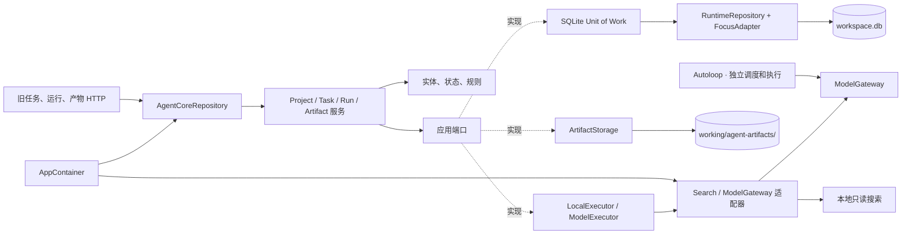
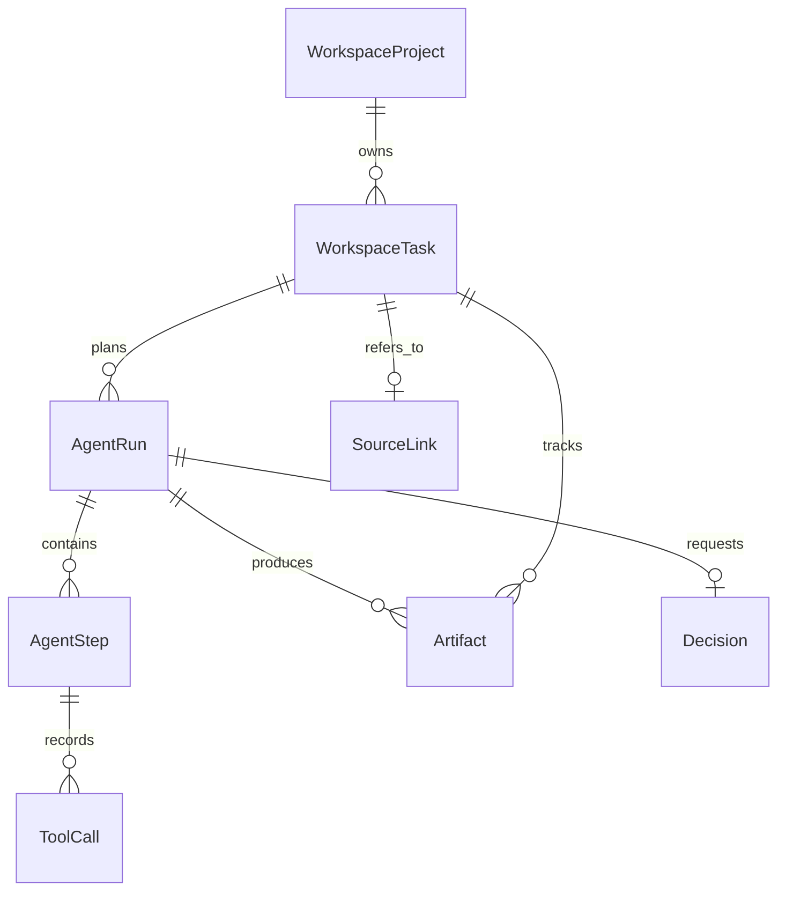
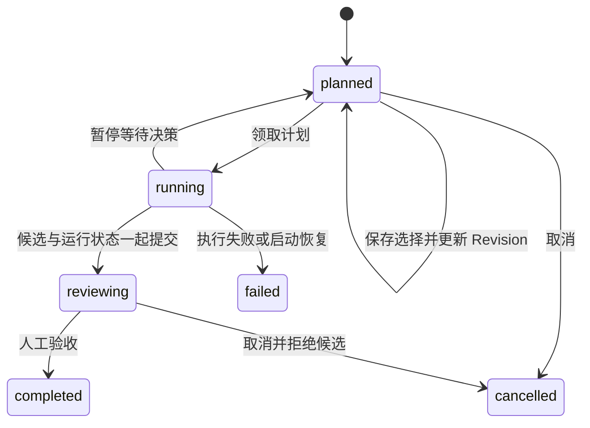
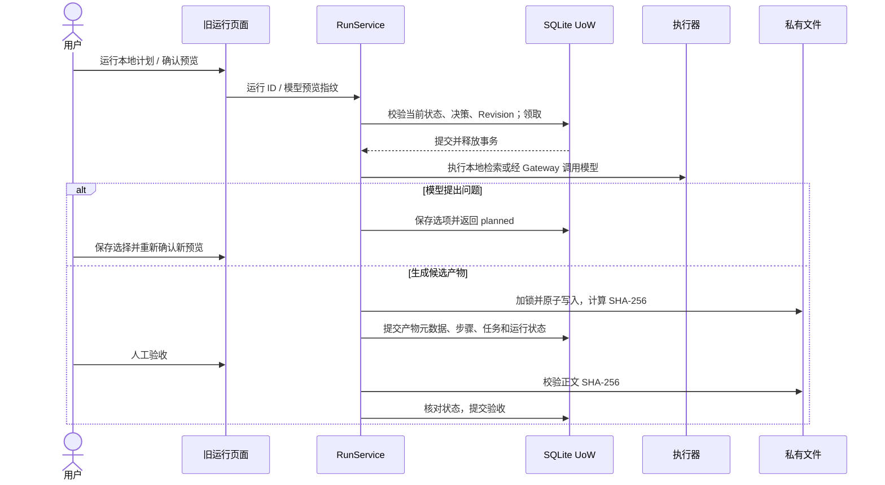

# Agent Runtime 领域架构

Task 04 将实验性的旧任务运行时拆成四个应用服务。日常主入口 `/tasks` 仍由 Autoloop 工作流负责；旧任务、步骤、决策和候选产物由本页所述运行时负责。两套运行 ID、表、调度和恢复逻辑独立。

Domain 只依赖标准库和自身模型；应用层依赖端口，不执行 SQL、不处理 HTTP。组合入口注入 Search 和 Gateway；UoW 将 SQLite 仓储与 Focus 关联适配器绑定在同一连接。阶段行动与日常事件各有独立关联表，重复交接复用已有任务，只记录一次 Focus 活动。仅详情可见的任务不会出现在总览或模型预览中。

`SourceLink` 表示可选的阶段行动或日常事件关联；`Decision` 是既有的每轮最多一条决策记录。项目、任务、运行、步骤、工具摘要和产物元数据继续使用 `workspace.db` 中的 `agent_core` 版本 1–3，无新增迁移。产物正文仍位于私有数据根的 `working/agent-artifacts/`，目录和文件权限分别为 `0700` 和 `0600`。

任务从 `draft` 起步，随当前运行进入 `planned / running / reviewing / completed`，异常进入 `failed / cancelled`。失败或取消后可建新运行；重复规划复用已有的未执行计划。旧运行保留。正在执行的运行不能用普通取消接口终止；启动恢复只把遗留的 `running` 标记为 `failed`（`error_code=interrupted`），不会重新调用模型。产物从 `review` 转为 `accepted` 或 `rejected`。

| 策略 | 输入、输出和限制 |
| --- | --- |
| LocalExecutor | 用任务目标检索，必要时用标题再查；最多取 8 条，生成规则工作纸并执行确定性检查。工具记录只含计数。不调用模型或写入正式知识库。 |
| ModelExecutor | 预览包含指令、标题、目标、角色和已回答的决策。确认时按当前 Revision、模型配置与实际材料重算指纹，并校验输入上限。执行经现有 Gateway 限制输出和记账，只接受候选稿或单条决策；不新增工具、命令、文件修改或发布权限。 |

写事务用 `BEGIN IMMEDIATE`。创建任务与关联及活动一起提交；领取在同一事务校验 Revision、决策和状态；回答与任务 Revision 一起更新。模型和本地检索都在事务外运行。文件先原子写入，随后将产物登记和运行状态一起提交；事务失败会删除本次文件。验收读取并校验文件后，在写事务中复核登记和运行状态。

原有路由、表单、`app.agent_core` 公共实体、`AgentCoreRepository` 与 `request.app.state.agent_core` 保留。旧进程内调用可继续注入已有的本地结果或执行回调；HTTP 模型入口只走带指纹的确认方法。此次回退只需撤回 Task 04 的代码变更。

验证覆盖旧版升级与回滚、并发领取、预览过期与 Token 上限、决策续跑、私有过滤、故障回滚、中断恢复、产物验收和浏览器旧页面流程。完整检查结果见[变更记录](../changes/2026/2026-11-13-agent-runtime-domain.md)。

SQLite 与文件系统没有跨介质事务。进程若在文件写入后、SQLite 提交前被强制终止，可能留下未登记的私有文件；当前没有自动扫描删除。标准加密备份仍不包含候选正文。旧运行时仍只支持单个决策；统一两套运行协议、调度和数据不在本次范围。
