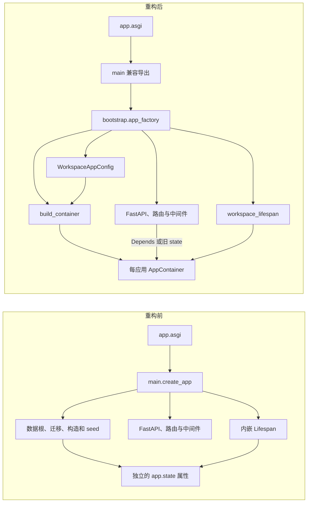
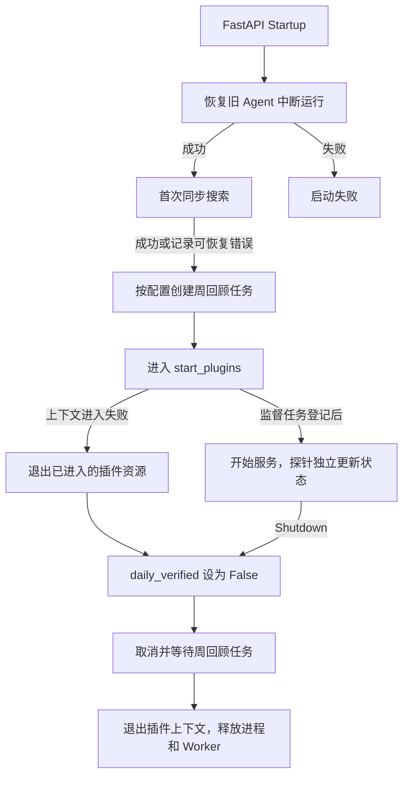

# 桌面应用启动与依赖装配

Task 02 延续 [Task 01 架构基线](audit-report.md)，保留桌面与移动的独立入口。桌面调用方继续使用 `from app.main import create_app`，生产入口仍为 `app.asgi:app`。

## 重构前后

## 配置和装配顺序

调用工厂时，`WorkspaceAppConfig` 解析数据根和显式 Vault 路径，记录调度及安全开关。默认使用 `WORKSPACE_DATA_DIR`，未配置时用 macOS Application Support。只传 `content_root` 时用该目录作为测试数据根，默认关闭 HTTP 安全约束；同时传入 `data_root` 或不传任何路径时默认开启，显式 `enforce_security` 优先。配置对象只持有路径和布尔值。

`build_container` 先准备私有目录，再初始化主库、移动库的独立迁移注册表。随后保持旧构造顺序，尤其是 Focus 先于旧 Agent。各 Repository 继续执行现有子系统迁移。装配后运行 `career.seed_career_radar()`，再读取插件目录下的 `enabled` 标记。配置无效导致 `WorkflowConfigurationError` 时，工作流进入原有降级，日常 Web 仍可独立启动。启用插件前的默认路径计算不会安装插件。

| 容器字段 | 实例与依赖 |
| --- | --- |
| `data_root`、`content_root` | 仓库外私有数据根与 Vault |
| `model_gateway`、`llm_client`、`model_tasks` | 网关、旧路由的 StyleClient 和人工模型任务；任务共享网关用量 Repository。只有 OpenAI-compatible 客户端作为自定义网关输入，其他 StyleClient 仍仅供旧路由调用。 |
| `career`、`focus`、`video`、`search` | 求职与学习、阶段及旧待办、视频私有文件、检索投影 |
| `agent_core` | 旧 Agent Runtime 兼容入口，注入 Search 和 ModelGateway 适配器 |
| `assistant`、`income` | 助手和收入 Repository |
| `wechat`、`mobile_store`、`obsidian` | 微信草稿服务、桌面用的移动配对仓储、Vault 桥接 |
| `workflow`、`plugin_directory`、`plugins_enabled` | 可选 Autoloop 工作流、私有安装路径与启用标记 |

## 依赖注入与兼容层

每次调用工厂创建一个独立容器并注入 `app.state.container`。新增处理器可用 `container: AppContainer = Depends(get_container)`，私有附件读取已采用该方式。旧的 `app.state.career`、`app.state.workflow` 等读取和赋值直接映射到容器字段，因此备份恢复替换 Career 后，两种入口获得同一个新实例。运行诊断、访问开关、插件导航仍作为普通 FastAPI state。

LocalOnly、CSRF、私有附件路径、SafeStaticFiles、HTML 404、路由名和禁用的 FastAPI 文档端点延续原有设置。移动网关继续通过独立的 `mobile_main.py`、`mobile_asgi.py` 装配，桌面只保留原有的设备管理仓储。

## 生命周期

启动恢复异常仍传播。搜索首次同步和写后同步复用同一个入口。启动时 SQLite 错误也会记录到 `search_sync_error`；后续成功清空提示。写后同步沿用原有异常处理范围。搜索的来源、触发条件和索引算法保持原有行为。周回顾仍使用确定性逻辑。Lifespan 持有插件运行管理器，先停止 Worker 并关闭客户端，再回收 Hub 和 Web。详细顺序见[插件运行时](plugin-runtime.md)。

## 文件清单

| 文件 | 作用 |
| --- | --- |
| [main.py](../../app/main.py) | 保留 `REPO_ROOT`、`create_app` 兼容导出 |
| [bootstrap/__init__.py](../../app/bootstrap/__init__.py)、[config.py](../../app/bootstrap/config.py) | 包入口及不可变启动配置 |
| [container.py](../../app/bootstrap/container.py)、[dependencies.py](../../app/bootstrap/dependencies.py) | 构造依赖、容器注入与旧 state 映射 |
| [app_factory.py](../../app/bootstrap/app_factory.py)、[lifespan.py](../../app/bootstrap/lifespan.py) | HTTP 装配、检索同步入口和资源启停 |
| [test_bootstrap.py](../../tests/test_bootstrap.py)、[test_lifespan.py](../../tests/test_lifespan.py)、[依赖规则](../../tests/architecture/test_dependency_rules.py) | 容器、兼容替换、初始化及异常退出检查 |

## 后续事项

Task 05 已将进程监督、静态注册和包校验拆开。搜索的来源枚举、SQLite 连接生命周期和 Repository 构造内迁移分别保留到对应后续工作。路线见[重构路线图](refactoring-roadmap.md)。
