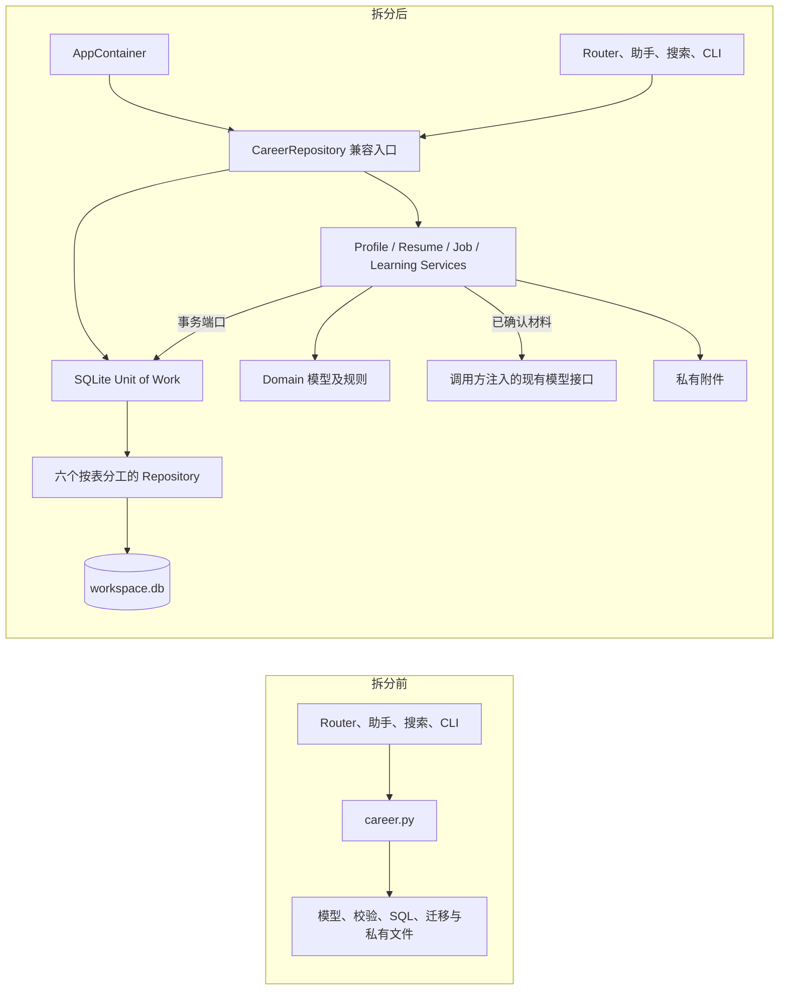

# Career 领域架构

Task 03 基于包含 Task 02 的 `e1f2fd0`，在 `refactor/career-domain-modules` 拆分 Career。原先的 [架构基线](audit-report.md) 记录了单文件仓储，下面描述当前实现。

## 领域和持久化归属

| 领域 | Entity 与值 | Application Service | SQLite Repository |
| --- | --- | --- | --- |
| Profile | `CareerProfile`、`CareerProject`、`PrivateDocument`。保留档案字段、证据、文档种类和项目状态。 | `ProfileService` 保存档案、提取候选、维护项目与私有文档。确认后的档案表单复用保存用例。 | `ProfileRepository` 写 `profile`，`DocumentRepository` 管 `documents`，`ProjectRepository` 管 `projects`。 |
| Resume | `ResumeVersion`、`ResumeAsset`。沿用 `StructuredResume`、Revision、来源指纹、模板键和证据引用。 | `ResumeService` 编排创建、导入、编辑、照片、定制和候选校验。DOCX、PDF、照片解析继续复用现有实现。 | `ResumeRepository` 管 `resumes`、`resume_assets`。 |
| Job | `JobOpportunity`、`JobStageEvent`、`JobResumeSubmission`、`JobSkillGap`。保留状态标签和次序、日期、档位、行内白名单及幂等标识。 | `JobService` 管投递写入、阶段更新、实际投递快照和技能候选。 | `JobRepository` 管 `jobs`、`job_events`、`job_resume_submissions`、`job_skill_gaps`。 |
| Learning | `Skill`、`LearningTask`、`CapabilityDomain`、`JobCapability`、`LearningReference`、`LearningPath`、`LearningStage`、`LearningStageReference`、`LearningCampaign`、`Quest`、`QuestEvidence`。保留状态、等级、前置关卡、验收证据与 XP 口径。 | `LearningService` 管技能、任务与进度、研读、关卡和 Radar 初始化。 | `LearningRepository` 管技能、能力、路线、研读、任务和战役表，含 `job_capabilities` 读投影。 |

领域模块沿用现有 dataclass 和序列化表示，规则直接引用标准库或纯简历逻辑。应用服务接收事务端口，模型用例显式接收现有模型调用方法，路由仍负责预览、人工确认、HTTP 错误映射和模板。仓储通过同一个连接读写所属数据，跨域用例通过服务组织。完整表归属见[数据所有权](data-ownership.md)。

## Unit of Work 与跨域用例

| 用例 | 事务边界 |
| --- | --- |
| 创建与更新简历 | `ResumeService` 在一笔写事务中读取文档、项目证据、当前简历、目标职位及所需照片，计算来源指纹后写入。现有主简历、定制版本和 Revision 规则保留。 |
| 导入 DOCX 主简历 | 在写事务外解析文件并生成导入前快照。在同一写事务登记新照片和主简历。失败时回滚 SQLite 并清理本次写入的照片文件。 |
| 记录实际投递版本 | `JobService` 查职位，再经 `ResumeRepository` 读简历。随后由 Job 仓储写入当时的 Revision、结构化正文、模板和照片引用。 |
| 清理简历照片 | `ResumeService` 在同一写事务检查当前简历和历史投递快照的引用，提交登记删除后再清理文件。 |
| 编辑投递与确认技能候选 | 岗位字段和阶段事件一起提交。整批已确认技能在同一连接查建 Skill 和写入 Job 差距，任一失败则全部回滚。 |
| 清关和学习初始化 | `LearningService` 持有写事务完成证据校验、清关、下一关解锁及战役完成。Radar 保留稳定 ID、原归档规则和已保存进度。 |

`SQLiteUnitOfWork` 复用工作台的 SQLite 连接函数。写事务使用 `BEGIN IMMEDIATE`，读事务提供一致视图。提交或回滚后关闭连接。模型调用和 DOCX 解析在写事务外执行。私有附件使用工作台的文件锁和原子替换。文件系统与 SQLite 各自提交，进程异常终止可能留下未登记的私有文件，应用内异常路径会执行补偿清理。

## 兼容与迁移

`app.career` 兼容导出原有模型、常量、`SCHEMA_VERSION`、`validate_document` 和 `CareerRepository`。Facade 显式委托到服务或仓储，保留旧方法、路径属性、`connect()` 与 `snapshot()`。AppContainer 通过现有 `career` 字段持有 Facade，应用服务随它构造。备份恢复换掉 `app.state.career` 时，容器与调用方一起读取新实例。DOCX CLI 保留原入口。

迁移代码归到 `infrastructure/sqlite/schema.py` 和 `migrations.py`。现有 `workspace.db`、`schema_migrations` 的 `career` 子系统及第 1–8 版 SQL 继续使用。历史数据库仍经原机制快照和迁移。文档与照片沿用原路径，文件保持 `0600`，私有目录保持 `0700`。代码回退无需回滚数据库版本。

## 代码位置与后续

- 领域模型、端口和服务位于 `app/career/domain/` 与 `app/career/application/`。兼容入口及事务装配见[仓储 Facade](../../app/career/repository.py)和[Unit of Work](../../app/career/infrastructure/sqlite/unit_of_work.py)。
- 两个既有 Router 继续承接表单、预览、确认与模板响应。已迁出技能候选确认、模型调用及候选校验、简历导入与定制等编排。剩余页面视图组装留在原文件。 [投递与学习路由](../../app/routers/career_learning.py) [简历路由](../../app/routers/resumes.py)
- 测试覆盖模型和依赖方向、同连接与异常回滚、旧数据、审批、照片引用及投递快照。现有搜索、助手与 CLI 仍通过兼容入口读取。
- 可在后续搜索任务中为 Career 提供精简读投影，减少逐项查询。Task 04 可以复用显式服务装配和单事务做法，保持收入领域自己的金额规则和迁移序列。
