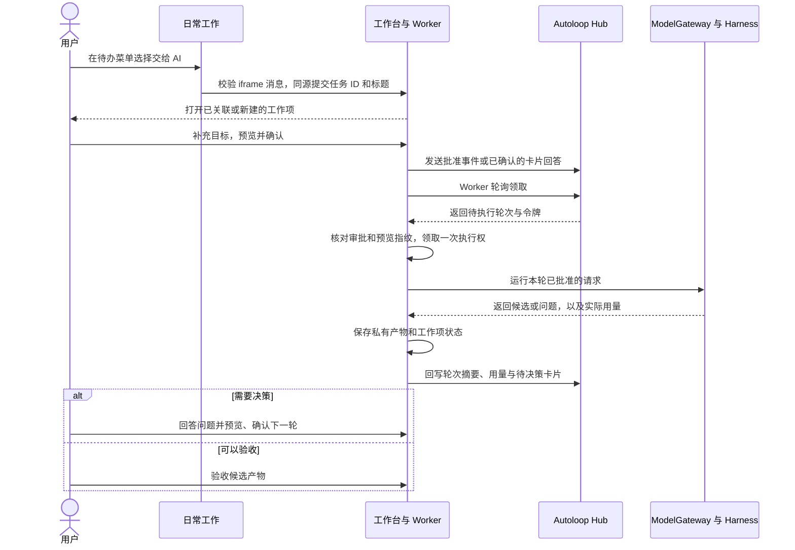
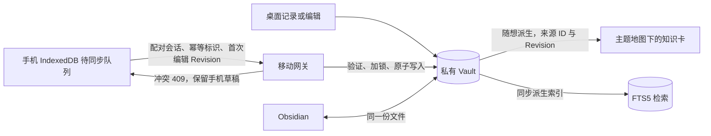

# 工作台关键数据流

本页说明当前各条流程如何传递数据、由谁写入、用户在哪里确认，以及失败后可以从哪一步恢复。组件和运行入口见[系统架构](README.md)。

## 日常待办到 AI 产物

1. **交接。** 「交给 AI」只传任务 ID 和标题，父窗口校验来源和 iframe 身份，之后提交带 CSRF 的同源请求。重复交接返回已有工作项。工作台也支持直接新建事项。源待办、排期和计时继续以 Super Productivity 为准。
2. **触发。** 手动触发、Cron 或其他规则可以让 Autoloop 先派发轮次。若找不到对应的已批准工作项，Worker 只创建待确认工作项和卡片。这里的调度自动化止于排队和待确认，用户批准才触发模型请求。
3. **执行。** `workspace.db` 保存任务目标、审批指纹、关联轮次和交付标记。Worker 在领取后原子地把状态从 `approved` 更新为 `running`，重建预览并核对指纹后才调用网关。工作台向 Hub 发送任务标识和调度信息，候选正文及自由文本回答由工作台的私有文件保存。
4. **续跑与验收。** 有问题时，下一轮将用户回答带入新的预览，确认后重新派发。Autoloop 的 `done` 表示当前轮次已回执，候选产物是否已验收由工作台记录。源待办由本人在日常工作标记完成。结果不明或调用超时后，工作项需要重新预览和确认。
5. **可观测性。** 浏览器使用 `GET /workflow/control/state` 读取快照。SSE 只转发事实序号与变更提示，控制中心刷新相关投影。轮次详情经 `GET /workflow/control/runs/{run_id}` 读取上游追溯事实和本地关联。断线时显示上一次快照并标记过期。终态回放使用同一批事实投影重建历史状态，Session 页面从受保护的本地轮次文件读取 SDK 生命周期。轮次可见范围还受本机归档标记限制。

审批记录同时保留交付标记。Hub 派发确认丢失时，Worker 按同一轮次 ID 重送并识别重复；模型产物已保存而回执确认丢失时，只补送回执。启动恢复若找不到有效产物，工作项进入待重试并要求重新预览确认。

旧规划器及旧任务运行时使用自己的任务和产物记录。由旧待办或阶段行动创建的运行走原有 `agent_core` 路径，规则工作纸、模型预览与人工验收均留在旧执行入口。具体操作见[桌面插件指南](../guides/workbench-plugins.md)和[旧任务运行时](../features/agent-runtime.md)。

## DeepSeek 请求和界面可见范围

| 环节 | 传入或保留的数据 | 用户在哪里看 |
|---|---|---|
| 外发预览 | 系统指令和结构化任务材料，包括标题、目标及已选择的决策 | 工作项的「预览外发」或「预览续跑」 |
| 本机 Harness | 独立临时目录下的 `sdk-minimal` 会话。适配器停用工具和会话上传，通过 stdio 启动 Harness。 | 工作台用轮次关联显示会话标识。Harness 桌面会话列表使用另一套存储。 |
| 模型请求 | Harness 调用带一次性令牌的回环端点。工作台用预览中的指令和材料构造一次 DeepSeek Messages 请求，并施加 token 上限。真实 API 凭据由后端持有。 | 以工作项的确认前预览为准 |
| 回执与结果 | 候选正文或问题存到私有结果目录，Hub 保存摘要和用量，模型账本记录调用元数据。调用结束后清理 Harness 临时会话。 | 工作项显示产物和验收状态。轮次时间线显示执行事实与用量，完整外发原文只在确认前预览显示。 |

## 内容、知识与移动同步

- 随想、材料、知识卡、文章和回顾均使用独立的 Markdown 对象。知识卡记录来源 ID 和 Revision，来源变更后提示复核。工作台写回时保留未知 Obsidian Properties。内容周回顾与阶段周复盘分别维护。详见[内容模型](content-model.md)。
- 手机保存未同步操作和未归档随想快照。联网提交时由 Mac 检查设备会话、幂等标识与 Revision，冲突留给用户合并。详见[移动 PWA](../features/mobile-pwa.md)。
- FTS5 从允许进入检索的权威数据派生。桌面启动和相关写入后同步，手机提交随想后按条更新。普通搜索读取索引，私人工作纸、财务账本和实际投递快照保留在各自领域。

桌面日常工作页从 Super Productivity 的可信 iframe 请求今日快照，校验来源、窗口和请求 ID，再经同源 CSRF 接口保存。Mac 只接受北京时间当天的任务标题和时间；已配对的手机经移动网关读取，页面不进入离线缓存。快照写入由日常工作模块维护，Autoloop 或模型后端故障时仍可同步。

## 其他领域的写入路径

| 流程 | 输入、处理和权威写入 |
|---|---|
| 文章与公众号 | 独立文章 → 本机排版与预检 → 确认 → 微信官方接口创建草稿。完整待推送正文临时保存在私有文件，SQLite 保存指纹、状态和草稿 ID。超时或结果不明时由用户核对。 |
| 视频 | 文章派生为视频项目 → 保存分镜与状态到 `manifest.yaml` → 导出制作交接包。素材随项目私有存放。 |
| 求职与学习 | 档案、证据和原文件 → 主简历结构化版本 → 本机 JD 匹配 → 确认定制子版本。投递表按提交字段自动保存，阶段变化与事件同一事务，显式点击「记录」才冻结实际投递简历。学习阶段与证据由本人维护。 |
| 阶段行动与复盘 | 阶段、目标、交付物和行动写入 SQLite。本人选定今日和本周重点，实际进度用于阶段复盘。 |
| 决策助手 | 提取白名单摘要 → 预览 → 模型或人工桥接 → 校验结构化候选 → 逐项确认。持久记录保存摘要、引用和确认结果。当前可确认的行动是新建草稿随想或关联已有技能的学习任务。 |
| 收入与验证 | 记录机会和证据 → 冻结预测 → 手工登记实际收支与复盘。到账与净现金由已确认账目计算。 |

各目录、数据库与备份范围见[存储架构](storage.md)。
