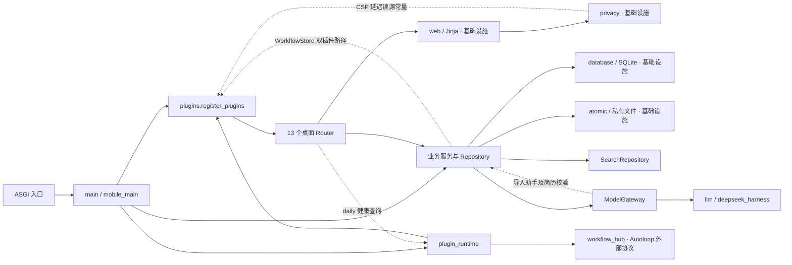
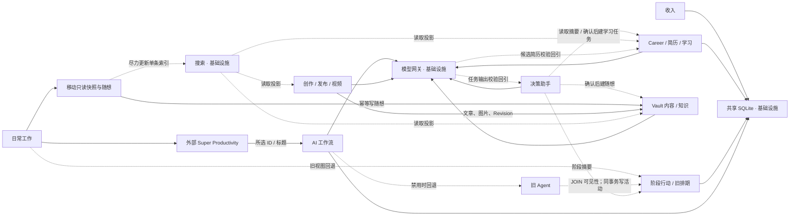
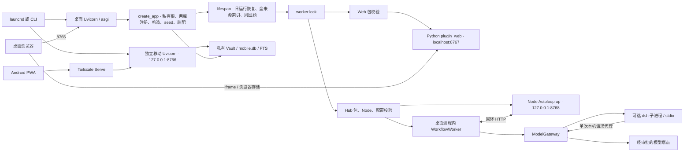

# 依赖图

基线 `6a8375e`。用 [AST 扫描器](../../tools/architecture_audit.py)读取 `app/` 的 70 个 Python 模块，得到 238 条去重的内部导入边。函数内导入计入源码依赖。静态分析未推断 `app.state`、字符串入口、动态导入、SQL 或远端请求，图 B、C 中这些边由调用链补充。全量逐文件边见[模块清单](module-map.md)；三图按阅读范围合并节点。

```bash
.venv/bin/python tools/architecture_audit.py
.venv/bin/python tools/architecture_audit.py --format json
```

图中实线为常规调用或导入，点线为跨域或反向依赖，标注「基础设施」的节点为多个领域共用，外部进程和存储单独画出。

## A. 全局模块依赖



源码有两个强连通分量，共 52 条位于循环内的边。一个是 `content → knowledge_store → content/workspace → content`，回边在 Markdown 链接改写函数内。另一个由 23 个模块组成，核心回路是 `plugins → routers → web → privacy → plugins`，还有 `plugins → routers.daily → plugin_runtime → workflow → workflow_store → plugins` 等。部分回边延迟导入，现有工厂导入与启动均通过，因此这里记录源码耦合和重构顺序风险。精确边集由[循环基线](../../tests/architecture/legacy_cycles.txt)锁定。

## B. 业务领域依赖



Assistant 到 Career 的写边来自路由中的确认用例。Legacy 到 Focus 的 SQL 边由 `AgentCoreRepository` 直接读取和调用 Focus 活动写入实现。模型网关回边表示静态导入，业务侧正向箭头多为实际调用，不能据此直接推断新的 Python import 循环。 `router → request.app.state.*` 由组合入口注入，其中 `/settings/backups/restore` 会在恢复后替换 Career 引用。

## C. 应用启动与外部进程



两套插件在同一桌面生命周期和进程锁下分别验证。Web 页面另以 HEAD 与 CSP 校验服务可用性；Worker 轮询回环 Hub 后更新 `ready`，两者都不是 Supervisor 自身的健康状态。已测损坏 Web 包、损坏 Hub 包和错误 Harness 配置的交叉隔离；共享锁打开失败、启动恢复异常和任务意外退出缺少同等级保护。启动、停止和权限约束见[系统架构](README.md)，重构方案见[目标架构](target-architecture.md)。
