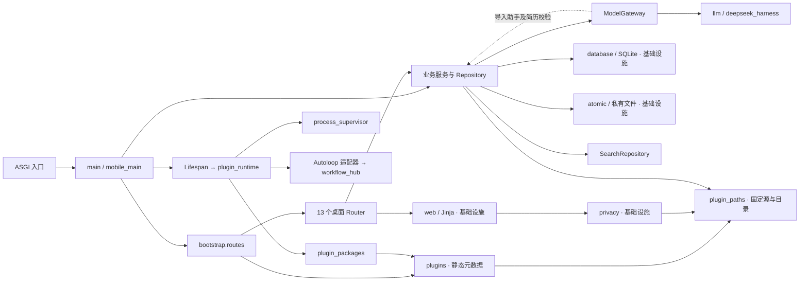
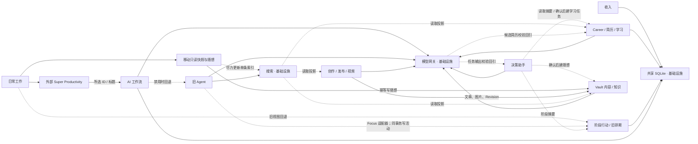
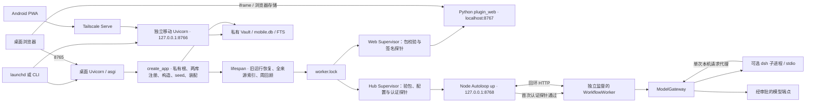

# 依赖图

基线 `6a8375e`。用 [AST 扫描器](../../tools/architecture_audit.py)读取 `app/` 的 70 个 Python 模块，得到 238 条去重的内部导入边。函数内导入计入源码依赖。静态分析未推断 `app.state`、字符串入口、动态导入、SQL 或远端请求，图 B、C 中这些边由调用链补充。全量逐文件边见[模块清单](module-map.md)；三图按阅读范围合并节点。

```bash
.venv/bin/python tools/architecture_audit.py
.venv/bin/python tools/architecture_audit.py --format json
```

图中实线为常规调用或导入，点线为跨域或反向依赖，标注「基础设施」的节点为多个领域共用，外部进程和存储单独画出。

## A. 全局模块依赖



Task 01 记录 52 条循环边。Task 05 拆开静态注册、源与目录和 Router 装配后，当前只剩 `content → knowledge_store → content/workspace → content` 的 4 条循环边，回边在 Markdown 链接改写函数内。精确边集由[循环基线](../../tests/architecture/legacy_cycles.txt)锁定。

## B. 业务领域依赖



Assistant 到 Career 的写边来自路由中的确认用例。旧 Agent 通过 [Agent Runtime 的 Focus 适配器](agent-runtime.md) 读取可见性和记录交接活动。模型网关回边表示静态导入，业务侧正向箭头多为实际调用，不能据此直接推断新的 Python import 循环。 `router → request.app.state.*` 由组合入口注入，其中 `/settings/backups/restore` 会在恢复后替换 Career 引用。

## C. 应用启动与外部进程



桌面 Lifespan 持有独占锁。Web 与 Hub 各自验包、探测、回收和退避。Hub 首次健康后启动 Worker，Worker 首次完成认证领取轮询后报告就绪。实现、状态机与回归见[插件运行时](plugin-runtime.md)。
