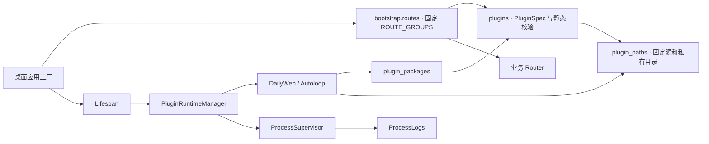
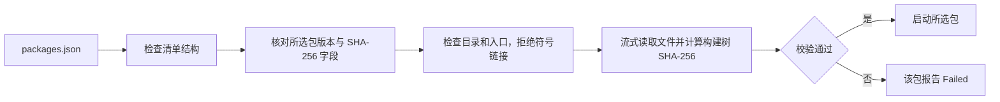
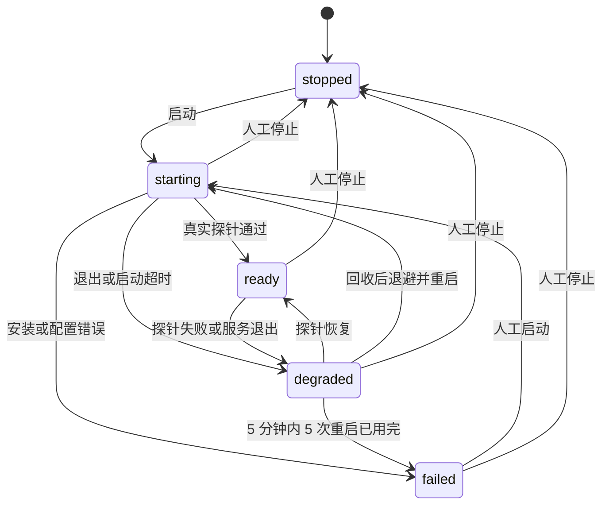
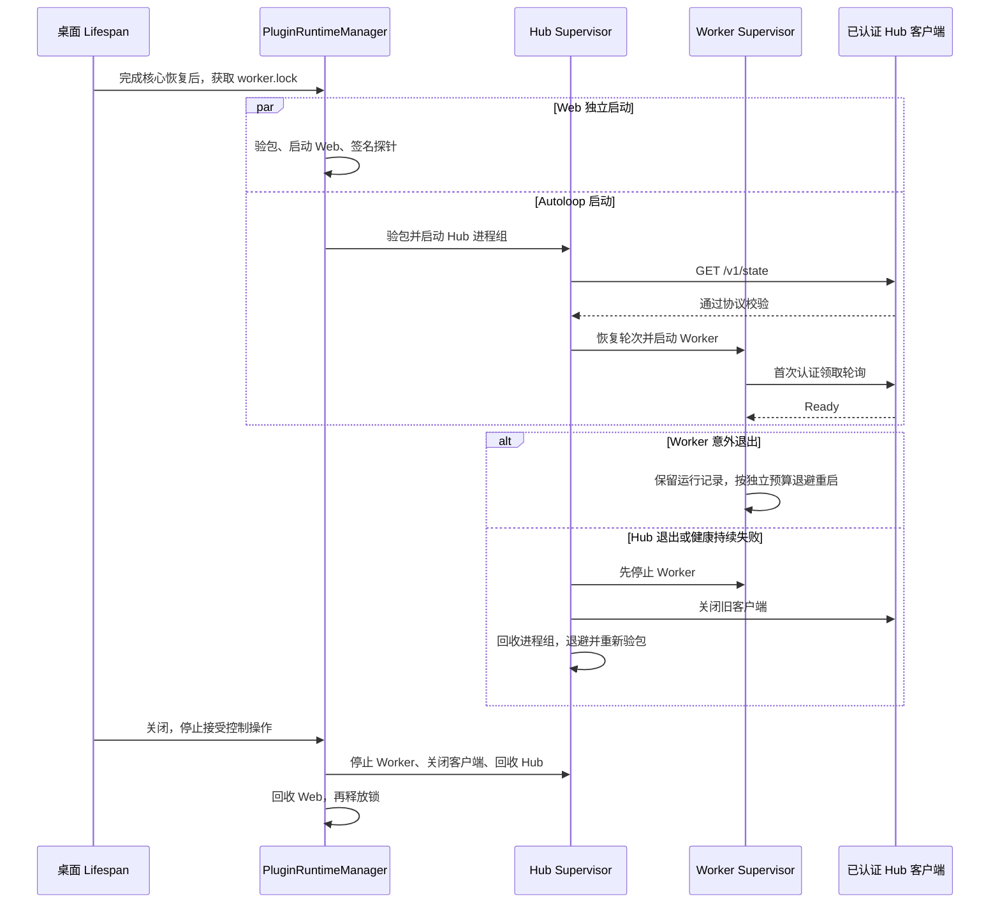

# Task 05 · 插件注册和进程监督

Task 05 开始于 `refactor/career-domain-modules` 的 `e1f2fd0`，工作树已有 Career 和 Agent Runtime 改动。基线有 245 条桌面路由和 17 条移动路由。插件、Lifespan、Bootstrap 和架构测试在基础环境通过 29 项，另有 1 项需要上游安装包。

## 注册和装配

原 `plugins.py` 同时持有导航和 Router。现在 `PluginSpec` 只保存十个可信内置插件的元数据。校验 ID、版本、主导航和依赖图，将共享能力 `model-gateway` 与内置插件区分。Bootstrap 的固定映射验证导航目标是无需路径参数的 GET 路由，再按原顺序装配 Router。公开状态仍用 `app.state.plugins`、`primary_nav`、`plugin_nav`。

## 包校验与更新

沿用 `working/plugins/`，固定 Super Productivity 20.0.0 和 Agent Autoloop 1.8.1，Autoloop 安装校验提交 `e8748fd0c2aad4013e5996c3188535567070f24a`。已有包的清单格式和哈希算法兼容。每次启动只校验目标包，清单整体损坏会同时影响两边。安装和 Web 更新在私有临时目录中完成，发布失败回退已经移动的条目。刷新 Web 不触碰 `autoloop-data/` 的规则、配置、凭据和运行日志。CLI 的 install、refresh-web、enable、disable 保留。

## 进程与健康检查

监督器使用 `create_subprocess_exec`、独立进程组和环境白名单，记录 PID、最近退出码、健康检查和重启时间。Web、Hub 和 Worker 各有监督器。初始退避 1 秒，按倍数 2 增长，最多 30 秒。Web 和 Hub 分别等待 15 秒和 30 秒。运行中连续 3 次探针失败时回收进程组，先发 TERM，最多等 5 秒，再发 KILL 并回收。

- **Web**。通过 `HEAD /` 检查 HTTP 200、精确的 `frame-ancestors` 和当前子进程对随机挑战的 HMAC 签名。首页使用同一探针才加入 iframe 和 CSP。实际浏览器源仍是 `http://localhost:8767`，用户数据留在该源的 IndexedDB。
- **Hub**。使用现有 Owner Key 客户端读取 `GET /v1/state`，确认协议对象与运行、规则及卡片列表结构。Hub 监听 `127.0.0.1:8768`。
- **Worker**。Hub 首次健康后才启动。Worker 首次完成认证领取轮询后报告 Ready。短时故障继续沿用原重连逻辑，持续失败或意外退出由 Worker 自己的监督器恢复。轮次领取和数据库写入的幂等条件保留，中断轮次对账不会重放已调用的模型请求。停止会向执行中的 Harness 传递取消信号并等调用退出。现有同步 HTTP 模型客户端的停机等待受请求超时约束。

锁文件为 `0600`，由桌面 Lifespan 独占。锁竞争或锁路径不可用时，桌面仍可启动，设置显示原因。核心 Agent Runtime 的数据库恢复失败仍会阻止应用启动。移动独立启动，未装配插件监督器。

## 日志与操作

子进程 stdout 和 stderr 单独采集并标记。每行读取缓冲最多 8 KB，日志每文件 5 MB，每服务一个轮转文件，私有目录和文件为 `0700/0600`。只保留明确允许的基础设施消息或分类摘要。凭据、认证头、模型正文、未知内容及超长行使用占位符。网页读取有限尾部并重新过滤。Worker 在同一进程内运行，故障记录为安全状态摘要。

`/settings/runtime` 分别展示 Web、Hub 和 Worker。已启用且持有锁时，可启动、停止或重启日常工作和 Autoloop。按钮通过固定插件 ID 和动作提交 POST，沿用本机访问与 CSRF 验证。操作不会删除待办、工作项或规则。

## 文件与验收

| 范围 | 新增或修改 |
| --- | --- |
| 注册与启动 | `plugins.py`、`plugin_paths.py`、`bootstrap/routes.py`、`bootstrap/app_factory.py`、`container.py`、`dependencies.py`、`lifespan.py` |
| 包和进程 | `plugin_packages.py`、`install_plugins.py`、`process_supervisor.py`、`process_logs.py`、`plugin_runtime.py` |
| 适配和协议 | `daily_plugin.py`、`autoloop_plugin.py`、`plugin_web.py`、`workflow_hub.py`、`workflow_worker.py`、`workflow_store.py` |
| HTTP 和诊断 | `privacy.py`、`routers/daily.py`、`routers/workflow.py`、`routers/system.py`、`templates/runtime_settings.html` |
| 回归 | `test_plugin_registry.py`、`test_plugin_packages.py`、`test_process_supervisor.py`、`test_plugin_runtime.py`、`test_workflow_plugins.py`、`test_lifespan.py`、`test_docs.py`、`tests/architecture/legacy_cycles.txt`、`tests/browser/test_daily_plugin_runtime.py` |

故障注入覆盖坏包、进程异常退出、启动和健康超时、预算耗尽、人工停止、日志限长和脱敏、锁争用与依赖逆序关闭。浏览器验收记录三个 Ready 状态，并验证重启 Web 后同一浏览器源的 IndexedDB 仍可读。真实 Autoloop 回归使用固定版本、虚构任务和隔离回环地址。结果见[变更记录](../changes/2026/2026-11-13-plugin-runtime.md)。

工作台进程被强制终止时无法执行 Lifespan 清理。端口被其他进程占用时会报告故障，由用户处理端口归属。手动启停是本次桌面会话的状态，持久启用由原 CLI 标记管理。
